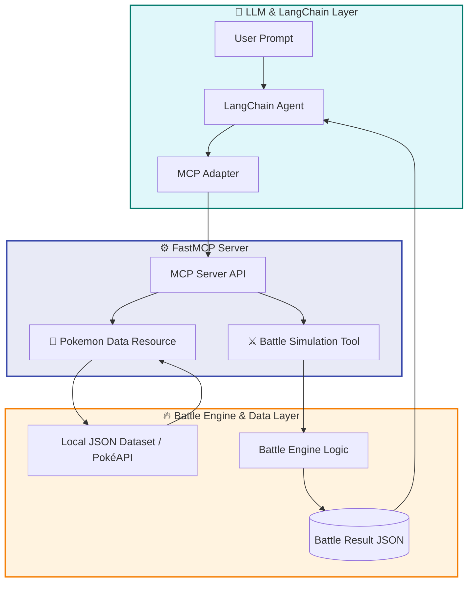

# 📘 **Pokémon MCP Battle Server**
Working for the first time with MCP tried my best to learn about MCP servers and work with them , take the help from various sources out there to build it 

_A modern MCP (Model Context Protocol) demo built with Python, FastMCP, and LangChain._

---

## ⚡ Overview

This project implements an **MCP-compatible API server** that allows LLMs or LangChain agents to:
- Access Pokémon data via an **MCP Resource**
- Simulate Pokémon battles via an **MCP Tool**

Built using:
- 🐍 **Python 3.11+**
- ⚙️ **FastMCP (from the MCP Python SDK)**
- 🧠 **LangChain + Google Gemini LLM**
- 💾 Local JSON Pokémon dataset (for offline testing)

---

## 🧩 Features

- **MCP Server** exposing Pokémon resources and tools
- **Battle simulation engine** (type modifiers, STAB, random factor, speed order)
- **Deterministic seeding** for reproducible simulations
- **LangChain client integration** (Gemini LLM can call your MCP tools)
- **Extensible** for status effects, more moves, real PokéAPI integration

---

## 🏗️ Project Structure

```
pokemon_mcp/
├── server/
│   ├── __init__.py
│   ├── main.py                 # FastMCP server (entrypoint)
│   ├── battle_engine.py        # Core battle logic
│   ├── resources.py            # Pokémon data resource
│   ├── tools.py                # Battle simulation tool
│   ├── pokedata.py             # Pokémon data loader
│   └── type_chart.py           # Type effectiveness mapping
│
├── client/
│   ├── __init__.py
│   ├── run_agent.py            # LangChain + Gemini client
│   └── battle_prompt.txt       # Prompt template
│
├── seeds/
│   └── pokemon_seed.json       # Local Pokémon dataset
│
├── tests/
│   └── test_battle_engine.py   # Unit tests
│
├── .env                        # Store your GOOGLE_API_KEY here
├── requirements.txt
└── README.md
```

---

## 🧠 Architecture Diagram

### 🔹 ASCII Overview
```
          +------------------------+
          |     LangChain Agent    |
          |  (Gemini / LLM prompt) |
          +-----------+------------+
                      |
                      v
           +----------+-----------+
           |   MCP Client (HTTP)  |
           |    via MCPAdapter    |
           +----------+-----------+
                      |
                      v
        +-------------+--------------+
        |      FastMCP Server        |
        |----------------------------|
        | Resources: pokemon-data    |
        | Tools: pokemon-battle      |
        +-------------+--------------+
                      |
                      v
        +-------------+--------------+
        |  Battle Engine + Data API  |
        |  (pokedata.py, type_chart) |
        +-------------+--------------+
```

---

### 🔹 Mermaid Architecture Diagram



---

## 🚀 Getting Started

### 1️⃣ Clone the repository
```bash
git clone https://github.com/yourusername/pokemon-mcp.git
cd pokemon-mcp
```

### 2️⃣ Install dependencies
```bash
python -m venv venv
source venv/bin/activate  # Windows: venv\Scripts\activate
pip install -r requirements.txt
```

### 3️⃣ Set up your `.env`
Create a `.env` file in the project root:
```
GOOGLE_API_KEY=your_gemini_api_key_here
```

### 4️⃣ Run the MCP server
```bash
uvicorn server.main:app --reload
```

### 5️⃣ Run the LangChain client
In a new terminal:
```bash
python client/run_agent.py
```

---

## ⚔️ Example Curl Request

```bash
curl -X POST http://localhost:8000/mcp/tools/pokemon-battle/run     -H "Content-Type: application/json"     -d '{"pokemon_a":{"name":"Pikachu"},"pokemon_b":{"name":"Charmander"},"seed":42}'
```

### Example Output
```json
{
  "winner": "Pikachu",
  "rounds": 3,
  "battle_log": [
    {"turn":1,"events":["Pikachu used Thunderbolt and dealt 77 damage.","Charmander has 123 HP remaining."]},
    {"turn":2,"events":["Charmander used Ember and dealt 36 damage.","Pikachu has 164 HP remaining."]}
  ]
}
```

---

## 🧰 Tech Stack

| Layer | Tech | Purpose |
|--------|------|----------|
| **Framework** | FastMCP | MCP server wrapper built on FastAPI |
| **Language** | Python 3.11+ | Main implementation |
| **LLM** | Gemini 1.5 (via LangChain) | Handles agent reasoning |
| **Orchestration** | LangChain + MCP Adapter | Enables LLM → MCP calls |
| **Data** | Local JSON / PokéAPI | Pokémon info |
| **Testing** | pytest | Validation and unit tests |

---

## 🧩 How It Works (Workflow Summary)

1️⃣ **LLM prompt**:  
   User asks the Gemini-powered agent:  
   > “Simulate a Pokémon battle between Pikachu and Charmander.”

2️⃣ **LangChain agent**:  
   Recognizes it can use the `pokemon-battle` MCP tool.

3️⃣ **MCP adapter**:  
   Sends an HTTP call to the local MCP server.

4️⃣ **MCP server**:  
   - Calls the `battle_simulation_handler()` tool handler.  
   - Uses Pokémon data (from local JSON).  
   - Runs the battle engine logic.  
   - Returns results (winner + logs).  

5️⃣ **LLM formats**:  
   LLM interprets the JSON response and generates a natural-language summary.

---

## 🧪 Testing

```bash
pytest -v
```

---

## 🧭 Future Improvements

- Add **status effects** (Burn, Poison, Paralysis)
- Add **critical hits** and **accuracy mechanics**
- Integrate live **PokéAPI** for dynamic stats
- Visualize battles via **LangGraph**
- Deploy on **Render / AWS / HuggingFace Spaces**

---


